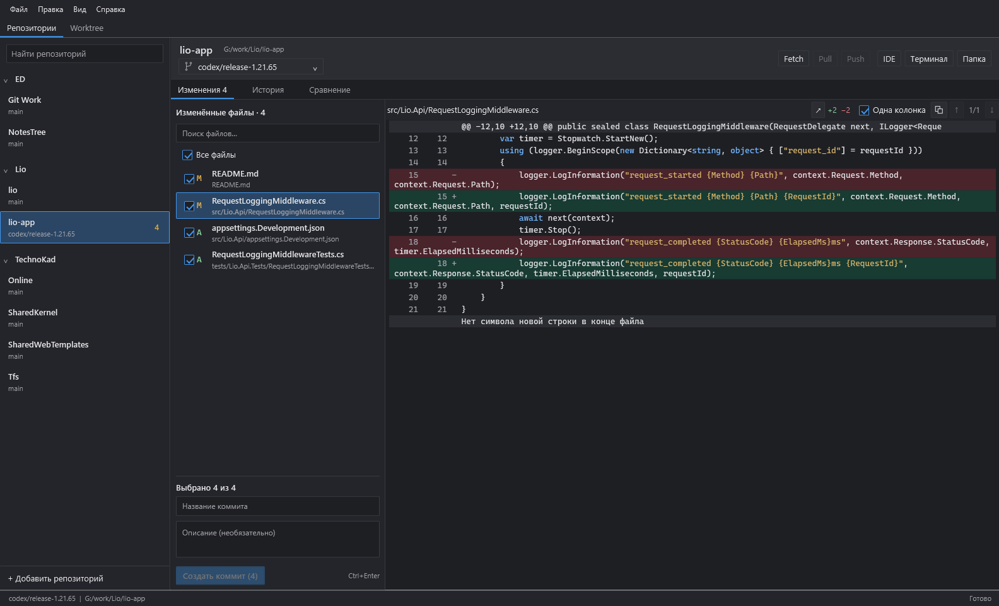
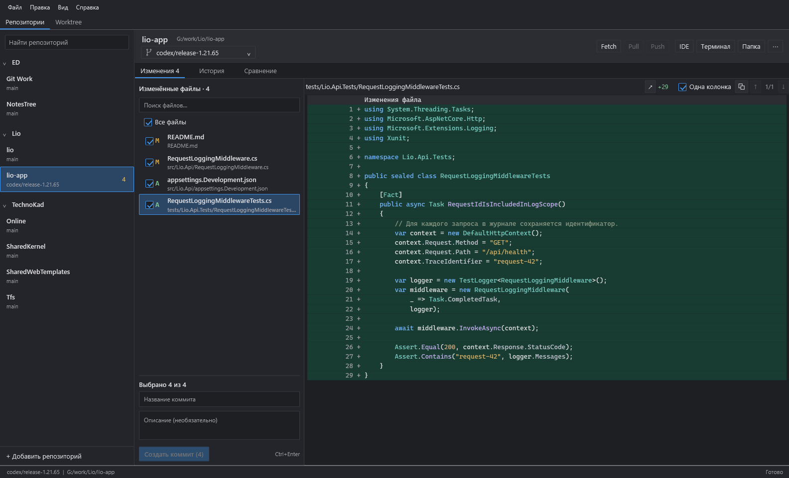
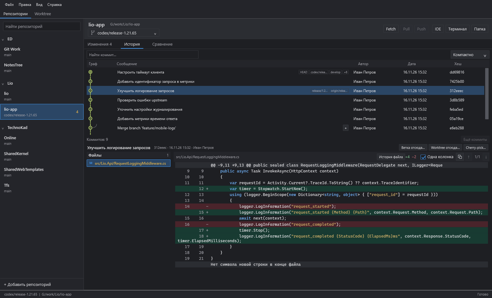
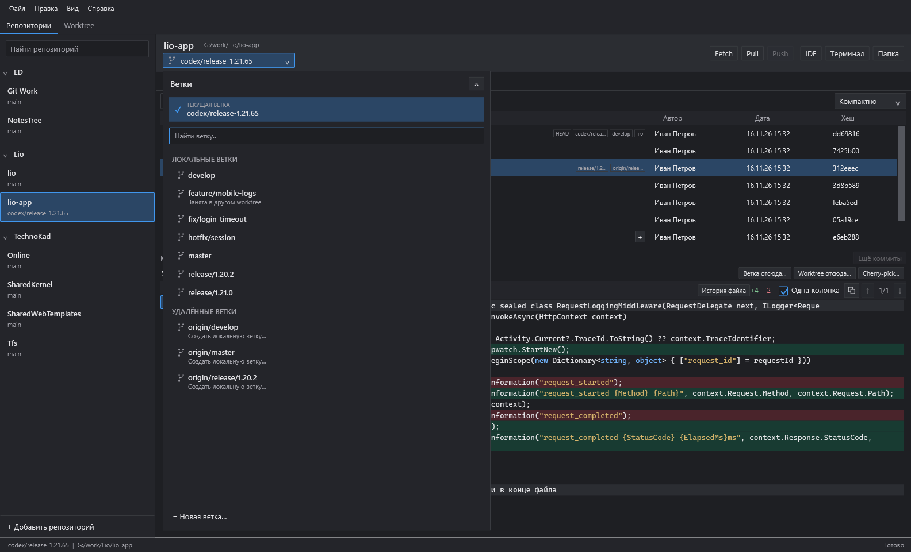
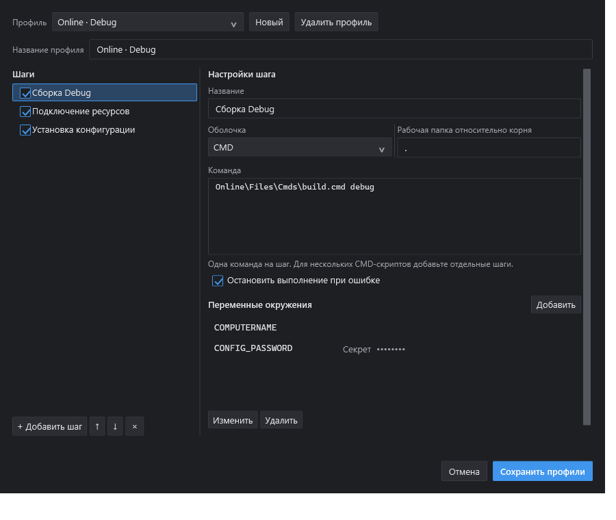

<div align="center">


# Git Work

A focused Git client. A home for your worktrees.

**English** · [Русский](README.ru.md)

  [](LICENSE)
</div>

Git Work brings everyday Git and multi-repository workspaces into one Windows app. Review changes, follow history, and keep parallel tasks in separate worktrees without losing track of their folders or branches.

The current stable release is **0.4.0**. See [the latest release](https://github.com/eddchervov/GitWork/releases/latest) for downloads and release notes.





## Two spaces, one workflow

| Repositories | Worktree |
| --- | --- |
| Your manually added local repositories and clones. | Automatically discovered worktrees and multi-repository bundles. |
| Changes, commits, history, branch comparison and synchronization. | Create isolated copies, choose their branches and open each repository in your IDE. |
| Add a folder or clone a repository from its URL. | Search by name, branch or path; keep related copies together. |

Worktree discovery never automatically fills your Repositories list. Add a particular worktree there yourself when you want to use it independently.

The Repositories and Worktree tabs keep their selected views independently; Repositories opens on **Changes**. Repositories are grouped by their parent folder. The sidebar always shows a repository's current branch and shows a change count only when the working tree is dirty. Right-click a repository to remove it from the list while keeping its folder.

## Review and commit

- Unified or side-by-side diffs, with added, changed and deleted files clearly distinguished.
- File checkboxes, a commit title and an optional description right below the changes list.
- Commit only the selected files; unchecked files stay outside that commit.
- A compact commit graph, file history, branches and worktrees from a commit, and cherry-pick.
- Fetch, pull and push with visible incoming and outgoing commit counts.
- For a local branch without upstream, **Publish branch…** opens a remote and new branch name chooser. Confirmation creates the remote branch and configures tracking for future Push/Pull operations. An existing remote branch is never overwritten.
- Branch comparison with an explicit source and destination.
- Browse local and remote branches in one searchable list with the current branch pinned. A clean repository switches to a selected local branch; switching is unavailable while it has changes. A remote branch opens the create-branch dialog with its source preselected. Branches checked out in another worktree are unavailable.
- Compact header controls for Fetch, Pull and Push sit next to the branch selector. Stash, IDE, terminal and folder actions are in the **…** menu.
- A flat interface with compact rows, a wide diff, C# syntax colors for keywords, types, methods, strings and comments, plus addition/deletion counts.
- Changed fragments stand out inside modified lines in both unified and side-by-side diffs. Code remains selectable and copyable; large replacements keep whole-line highlighting to bound preview work.
- Expand unchanged lines above, between and below diff blocks, 20 at a time or the whole gap. The same controls work in Changes, commit history, file history and branch comparison, in both layouts.
- File lists in Changes, comparison and history share a clear filename, muted path and colored status marker. [Comparison preview](docs/images/comparison-dark.png).
- Nested repositories and worktrees can be selected for a parent commit as Git commit references (`gitlink`); their preview shows the referenced hash. Their internal files are not copied into that commit.
- History above the selected commit's files and diff, with message, author, date, hash and commit search.





## Context menus

Right-click a local branch in the branch picker to delete it after confirmation. The current branch and branches checked out in worktrees are protected; an unmerged branch requires a separate warning. This action does not delete branches on the remote server.

File context menus in Changes, History and Comparison provide working-file opening, Explorer, file history and full or repository-relative paths. Changes also supports including a file in the commit, adding an exact file or parent-folder rule to `.gitignore`, and discarding changes. Before discarding, working and staged versions are backed up to `%LocalAppData%\GitWork\backups\discard`; the status bar shows the backup path. A `.gitignore` rule does not hide an already tracked file.

Use **Discard all…** beside the **Files** heading to discard the selected repository's ordinary file changes after confirmation, including staged and untracked files hidden by search. All working and index versions are backed up before discarding starts. Nested repositories, worktrees and ignored files are preserved.

## Stash local changes

Open **… → Stash…** in a repository or worktree header. Add an optional message and choose **Stash changes**; enable **Include untracked files** to save new files too. Ignored files stay in the working copy.

The stash list is shared by all worktrees of a repository. Preview saved **Working tree** and **Index (staged)** versions separately, with the same syntax colors and expandable diff context as other views. **Apply** restores changes and keeps the entry; **Apply and drop** removes it only after a successful apply. Conflicts keep the stash available. Existing tracked changes and overlapping untracked paths must be resolved before applying. Deleting a stash asks for confirmation.

## Work on several repositories together

A bundle groups worktrees for one task. Create one from **File → Create workspace…**. Each repository keeps its own branch and Git history. Select a repository to switch branches, open its IDE, terminal or folder, and review its status.

Removing a registered repository from the Repositories list only removes its entry; its folder stays on disk. When removing one worktree from a bundle, choose whether to remove only the bundle entry, preserving the folder and Git worktree registration, or delete the working copy from disk. Deleting the whole bundle removes its root folder and leftovers such as `.artifacts` after all worktrees are deregistered. Git Work warns and asks for confirmation if tracked or untracked files have uncommitted changes; ignored build files such as `bin` and `obj` do not block deletion. Main and bare repositories, and locked, foreign or nested repositories are protected. If root cleanup fails, the workspace stays listed so you can retry.

## Prepare a new worktree

Save command profiles once in **File → Preparation profiles…**, then select a profile when creating a worktree or bundle, including worktrees created from a commit. A profile can be the default for a repository or its parent-folder group. Clearing **Run commands** skips preparation for that creation without changing the default.

Each step has a name, CMD or PowerShell command, a working directory relative to the new folder, and a stop-on-error option. Bundle preparation starts only after all worktrees have been created and saved. For example, run these as three separate CMD steps from the bundle root:

```cmd
Online\Files\Cmds\build.cmd debug
Online\Files\Cmds\link-resources.cmd
Online\Files\Configs\install.cmd "Online\Files\Configs\development.7z" debug other "tm.land-%COMPUTERNAME%" "%CONFIG_PASSWORD%"
```

Set `CONFIG_PASSWORD` as a secret profile variable. Secrets are encrypted for the current Windows user and passed as environment variables: `%NAME%` in CMD or `$env:NAME` in PowerShell. Existing Windows environment variables are inherited. Working directories must stay inside the new worktree or bundle. Commands run without an interactive console; use non-interactive scripts.

The preparation window shows step results and a selectable log. A full journal is saved automatically under `%LocalAppData%\GitWork\logs\preparation`, including attempt headers, stdout/stderr, step results and exit codes. Open it directly or export it with **Save log…**. The window keeps only recent output so large builds stay usable; exporting always copies the full journal. Secret values are masked; lines longer than 8192 characters are hidden. A failed or stopped preparation keeps the created worktrees. Retry resumes from the failed step and skips steps that already succeeded. Run preparation again from a worktree's **⋯** menu, bundle settings, or **File → Run preparation…**.



## Install

1. Install [Git for Windows](https://git-scm.com/downloads/win), available on PATH.
2. Download the Windows x64 Setup from [the latest GitHub release](https://github.com/eddchervov/GitWork/releases/latest).
3. Run Setup and add your first repository.

The installer includes the .NET runtime. Release packages are currently unsigned.

## Make it yours

Choose **File → Language → English / Русский** and **View → Light theme / Dark theme**. The interface language does not translate your code, filenames, branch names or commit messages.

Use **Help → Check for updates** or the header bell, which appears when an update is available. Installed builds can download and apply a published update after you choose to install it. A portable development build first needs Setup to enter the installed update flow. No separate update server is required: releases and the update feed live on GitHub.

## Build from source

Requires Windows, the .NET 10 SDK and Git for Windows.

~~~powershell
dotnet run --project src/GitWork.App/GitWork.App.csproj
~~~

Run the checks from the repository root:

~~~powershell
dotnet run --project tests/GitWork.Checks/GitWork.Checks.csproj
dotnet run --project tests/GitWork.UiChecks/GitWork.UiChecks.csproj
~~~

Build the self-contained installer and update feed:

~~~powershell
./tools/Build-Release.ps1 -Version 0.4.0
~~~

See [Releasing](docs/RELEASING.md) for the draft-release workflow and the files that must be published together. Building does not publish anything.

## Settings and privacy

Settings are stored locally under %LOCALAPPDATA%\GitWork. Existing settings from WorktreeDesk are imported when the new settings file does not exist. Screenshots use demonstration repositories, not private projects. Build output, release packages and local settings do not belong in Git.

## Author and license

Created by [eddchervov](https://github.com/eddchervov). [Project on GitHub](https://github.com/eddchervov/GitWork).

Released under the [MIT License](LICENSE).
