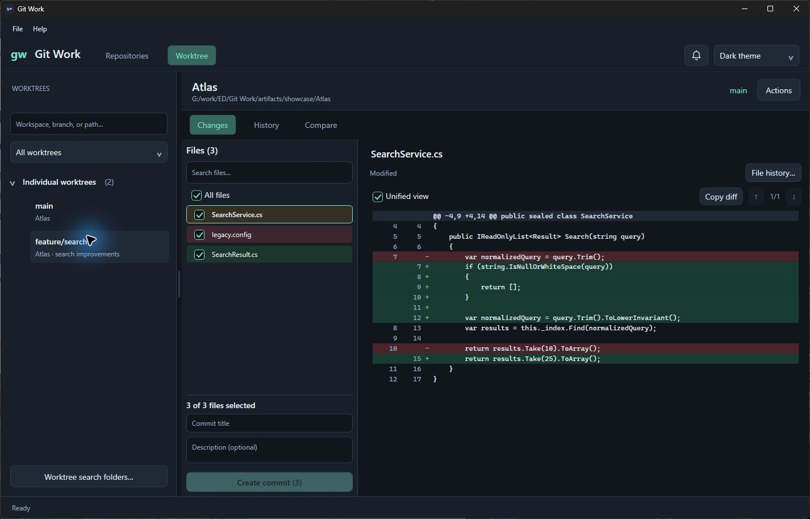
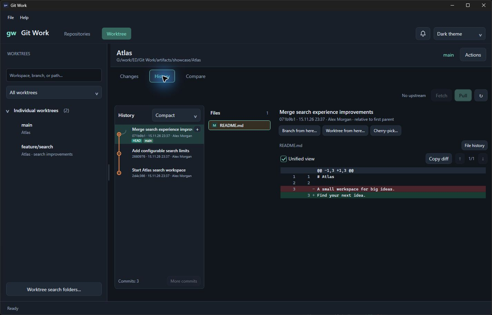

# Git Work

Git-клиент и рабочее пространство для worktree.

[English](README.md) · **Русский**

  

Git Work объединяет повседневную работу с Git и комплекты из нескольких репозиториев. Смотрите изменения и историю, ведите параллельные задачи в отдельных worktree и быстро находите нужную папку или ветку.

**0.1 — ранняя версия.** Интерфейс и сценарии ещё развиваются. Замечания и воспроизводимые сообщения об ошибках приветствуются.

## Два раздела

| Репозитории | Worktree |
| --- | --- |
| Вручную добавленные локальные репозитории и клоны. | Автоматически найденные worktree и комплекты для задач. |
| Изменения, коммиты, история, сравнение веток и синхронизация. | Отдельные копии, выбор веток и запуск каждого репозитория в IDE. |
| Открытие папки или клонирование по URL. | Поиск по имени, ветке и пути, объединение связанных копий. |

Поиск worktree не заполняет список «Репозитории». Нужную копию можно добавить туда вручную для самостоятельной работы.

## Изменения и история

- Сравнение в одной или двух колонках; добавленные, изменённые и удалённые файлы различаются цветом.
- Галочки у файлов, название и необязательное описание коммита прямо под списком.
- В коммит входят только выбранные файлы.
- Компактный граф, история файла, создание ветки или worktree от коммита и cherry-pick.
- Fetch, pull и push со счётчиками входящих и исходящих коммитов.
- Сравнение веток с явно выбранными источником и назначением.

## Комплекты

Комплект объединяет worktree для одной задачи. У каждого репозитория остаются своя ветка и история. Кнопки «Открыть Git» и «Действия» позволяют работать с конкретным участником: открыть IDE, переключить или создать ветку.

Репозиторий можно исключить из комплекта, сохранив папку. Физическое удаление worktree — отдельное действие с проверками незакоммиченной работы.

## Установка

1. Установите [Git for Windows](https://git-scm.com/downloads/win), доступный через PATH.
2. После публикации первого релиза скачайте Windows x64 Setup из [GitHub Releases](https://github.com/eddchervov/GitWork/releases).
3. Запустите установщик и добавьте первый репозиторий.

Установщик включает .NET. До первого релиза приложение можно собрать из исходников. Пакеты пока не имеют цифровой подписи.

## Язык, тема и обновления

Выберите **Файл → Язык → English / Русский**. Доступны светлая и тёмная темы. Язык интерфейса не меняет код, имена файлов, веток и сообщения коммитов.

Проверка обновлений доступна в **Справка → Проверить обновления** и через колокольчик. Установленная версия сможет скачать и применить опубликованное обновление по вашему действию. Для перехода с переносной сборки на этот механизм сначала нужен Setup. Отдельный сервер не требуется: релизы и файлы обновлений размещаются на GitHub.

## Сборка

Нужны Windows, .NET 10 SDK и Git for Windows. Команды выполняются из корня проекта.

~~~powershell
dotnet run --project src/GitWork.App/GitWork.App.csproj
~~~

Проверки:

~~~powershell
dotnet run --project tests/GitWork.Checks/GitWork.Checks.csproj
dotnet run --project tests/GitWork.UiChecks/GitWork.UiChecks.csproj
~~~

Установщик и файлы обновлений:

~~~powershell
./tools/Build-Release.ps1 -Version 0.1.0
~~~

Процесс выпуска описан в [Releasing](docs/RELEASING.md). Сборка ничего не публикует.

## Настройки

Настройки хранятся локально в %LOCALAPPDATA%\GitWork. Если нового файла ещё нет, импортируются прежние настройки WorktreeDesk. На скриншотах используются демонстрационные репозитории. Результаты сборки, пакеты релизов и локальные настройки исключены из Git.

## Автор и лицензия

Автор — [eddchervov](https://github.com/eddchervov). [GitHub проекта](https://github.com/eddchervov/GitWork).

Открытая лицензия [MIT](LICENSE).